# Studio Experience 2.0 review

Built from main `188fb59`, carrying the two commits from still-open PR #16. PR #15 is merged. Neither this change nor PR #16 was merged or deployed by this task. This PR includes the cleanup rather than depending on it being merged separately.

## Implemented

- Dedicated vinyl Home with CSS grooves/reflections, a center label exactly one-third of the outer diameter, silent latest-lesson entry, four secondary destinations and a triangular-dot Studio Menu.
- Grouped global menu covering all existing major areas, including the progression book. Existing task dialogs, composer, saved progression library and guided studies are reused. Browser task history is retained; area history is added without reopening a closing task.
- Compact dark archive and lesson instrument panels, warm ivory score surfaces, champagne selection, restrained static glint. No animation library or backend.
- Score + Notes, Score Only and Notes Only persist. Untimed exercises are explicitly pitch/voicing studies in practice registers, with no invented measured arrangement. The November 8 score uses the verified four-measure rhythm, rests and tied LH values. Playback retains the existing plan and scheduler; score highlights use its frame events, not another clock.
- Silent shape selection, horizontal measures, adjacent LH/RH reference, Play/Pause/Stop, tempo/loop, optional keyboard and collapsed Tips. Resume restarts the current measure (or untimed audition) so held notes are not silently omitted.
- Global lesson-view/register preferences, contextual melody variation and view controls, existing sound preferences/diagnostics. Recovery uses the existing audio unlock/reset API without leaving the current task. Switching areas stops weekly playback as well as studio playback.
- Existing lesson/source JSON, progress keys, composition model, audio engine and scheduler remain unchanged. New preferences use separate keys. Service-worker cache updated with new modules/styles.

## Reference comparison

The supplied approved three-screen mockup guides the black vinyl, small ivory label, compact four-tile Home, dark rounded instrument panels, ivory score, inline hands, number strip and triangle-dot menu. Implemented screens contain real lesson pitches, rather than copying the mockup's illustrative notation. Archive titles omit historical week prefixes as requested. Effects are deliberately quieter than the mockup's photographic glints. Tablet layouts expand the archive into two columns and retain readable score dimensions.

## Actual screenshots

### iphone — home

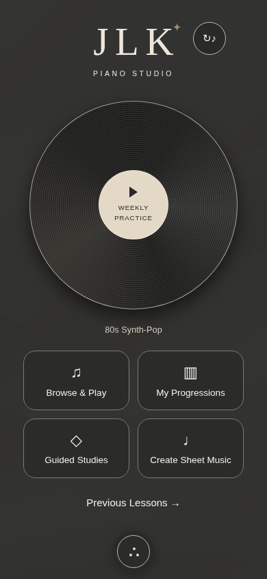

### iphone — menu

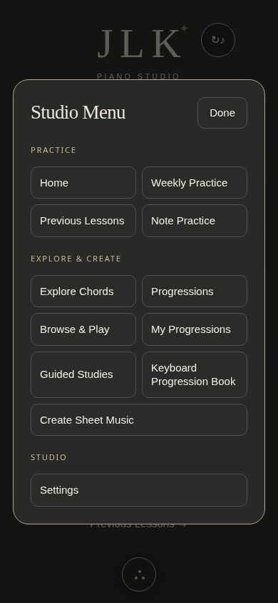

### iphone — archive

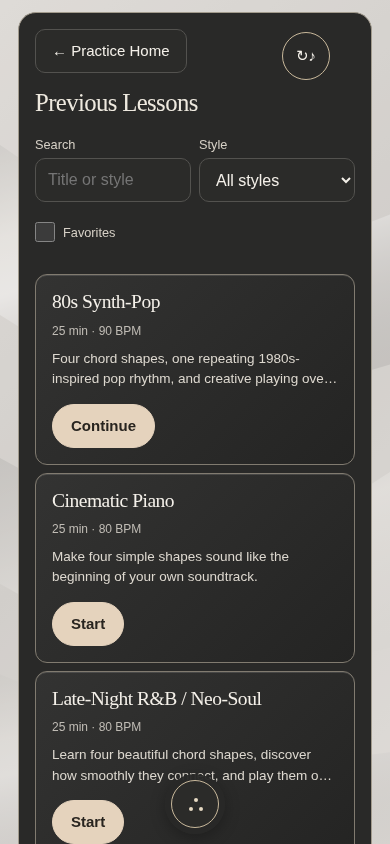

### iphone — score-notes

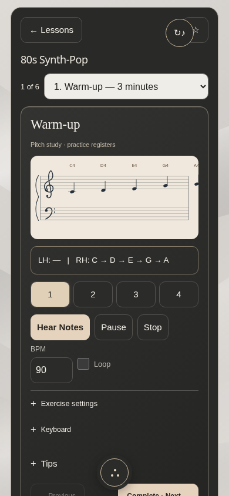

### iphone — score-only

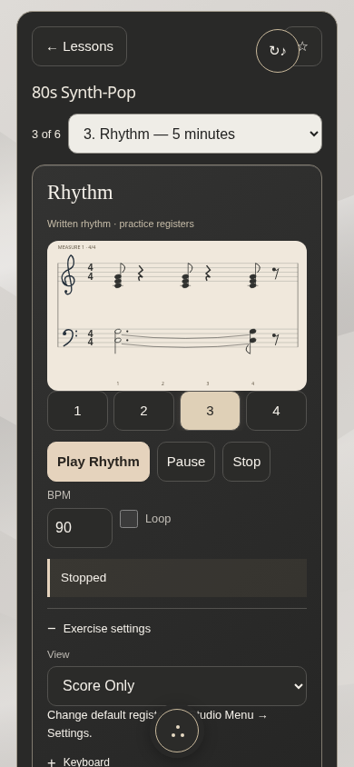

### iphone — playback

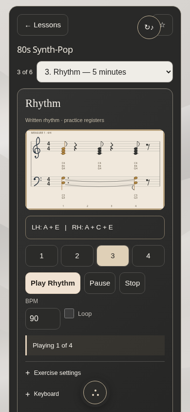

### iphone — settings

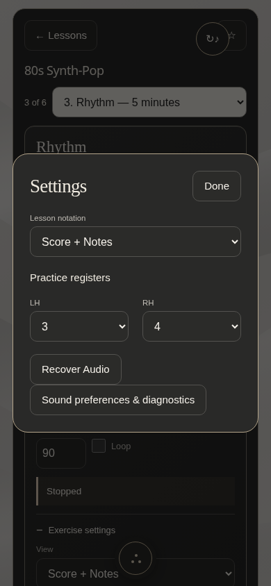

### ipad — home

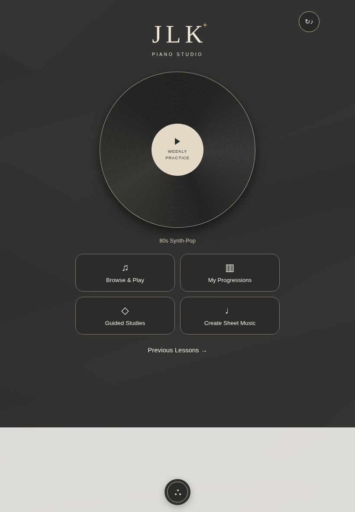

### ipad — menu

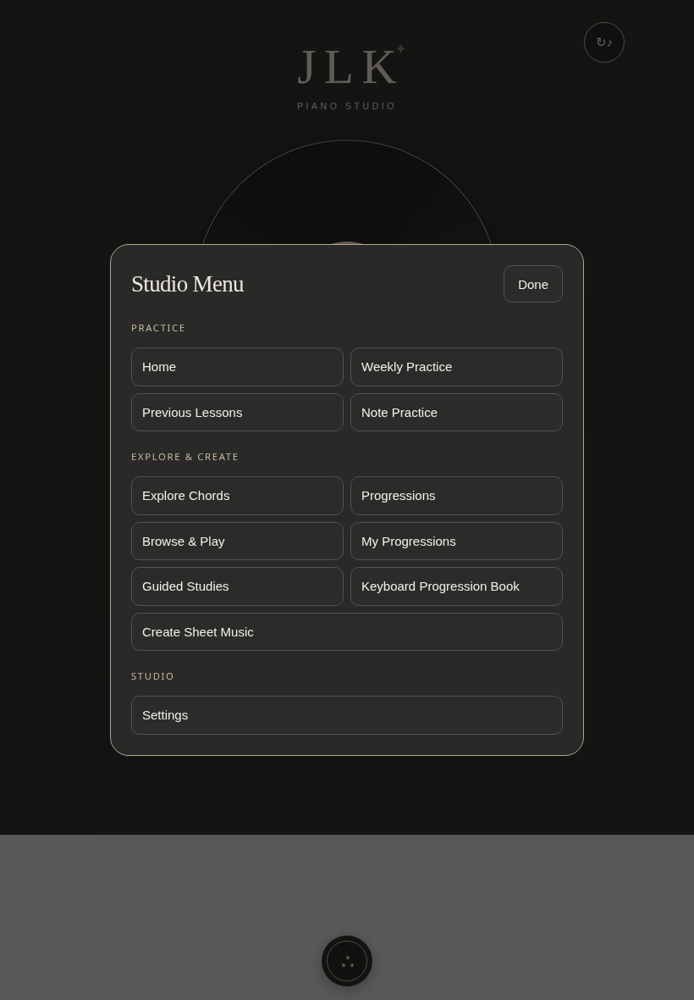

### ipad — archive

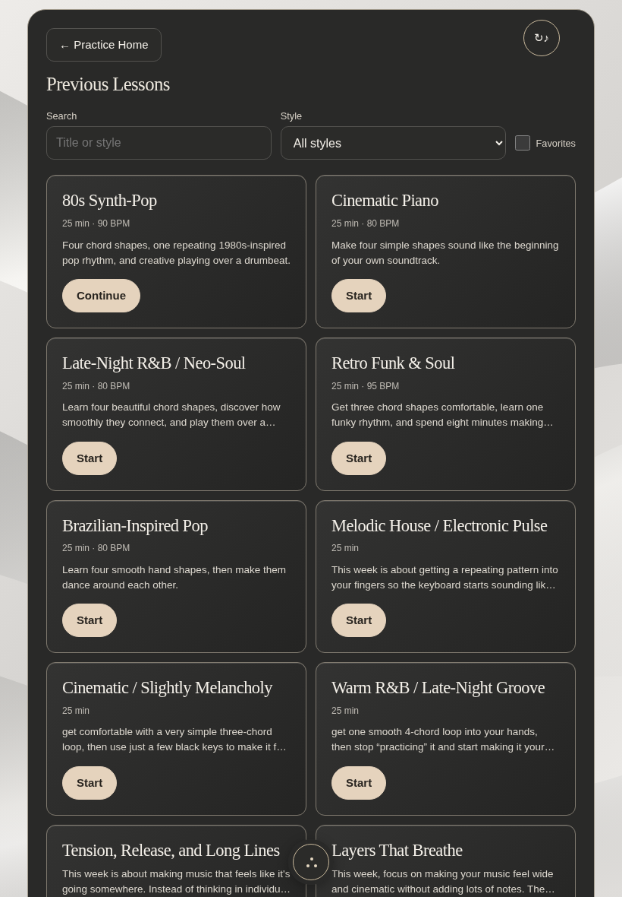

### ipad — score-notes

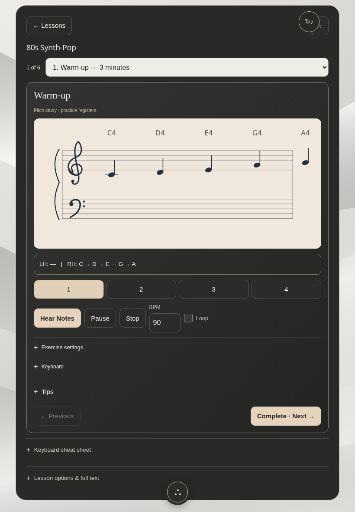

### ipad — score-only

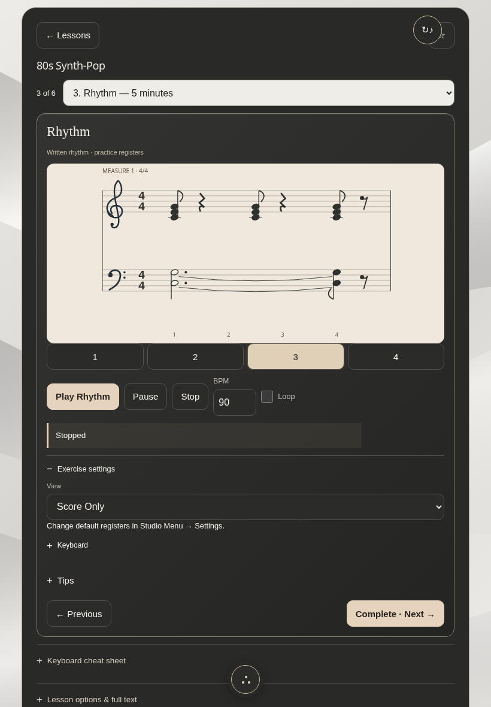

### ipad — playback

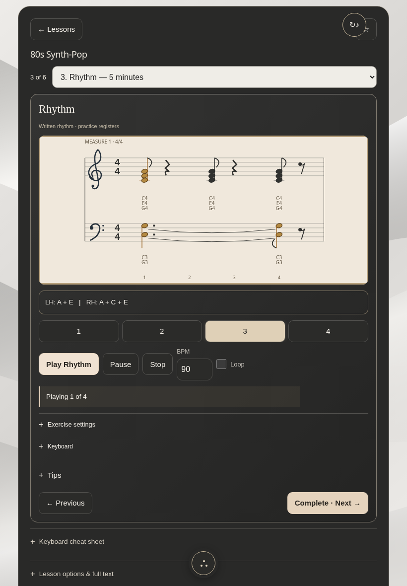

### ipad — settings

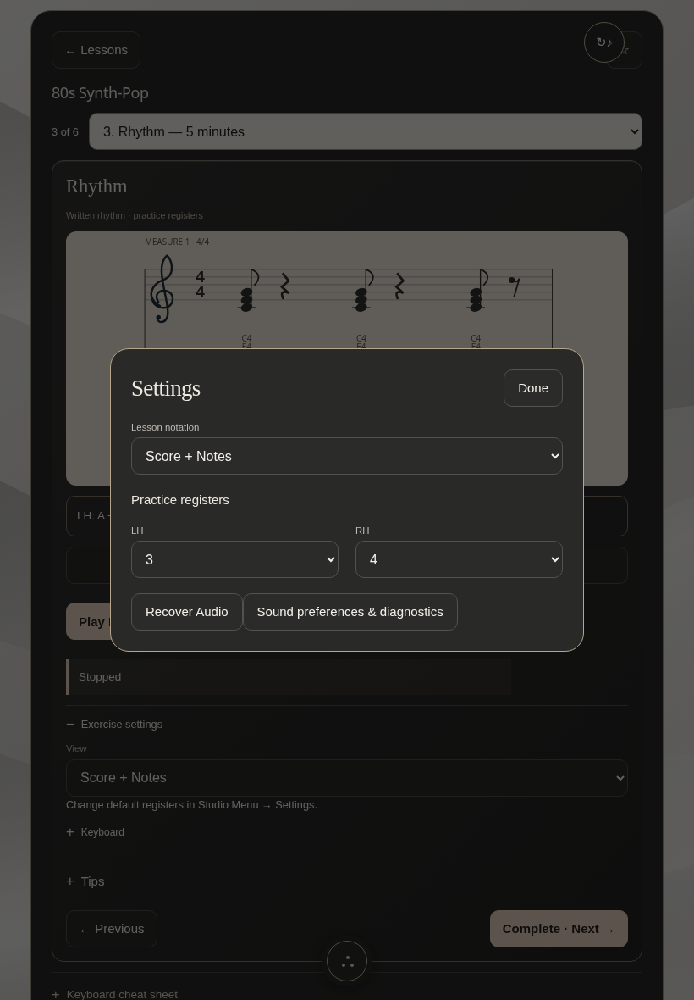

## Validation and limitations

- 65 Node tests passed, including a new test proving score adaptation leaves every scheduler event unchanged and accounts for four beats in each hand/bar. Seven Python unit tests passed.
- The Studio 2 browser workflow passes at iPhone and iPad sizes: all requested captures, silent entry/selection, score preferences, playback highlighting, pause/resume, global settings, composer save, audio recovery without navigation, return Home, responsive widths and offline score reopening.
- The full existing composer browser regression was updated to enter via Studio Menu and passed: note/rest/chord entry, RH/LH, suggestions and immutable previews, playback, saved library, backups, PDF output and offline reload.
- Older layout-specific browser scripts still target the retired top toolbar/weekly controls and are not claimed as passing Studio 2 tests. They need further conversion to the new navigation. Unit coverage for their music models remains passing.
- Chromium automation is not physical Safari/iPhone/iPad verification. Speaker/Bluetooth audibility, interruption/background recovery on real Apple devices, installed Home Screen updates and native text sizing require device checks. No claim is made to reset hardware speakers or OS routing.
- Untimed sources remain studies, not reconstructed arrangements. Practice registers are adjustable. Resume repeats the current measure rather than sustaining a mid-note continuation.
